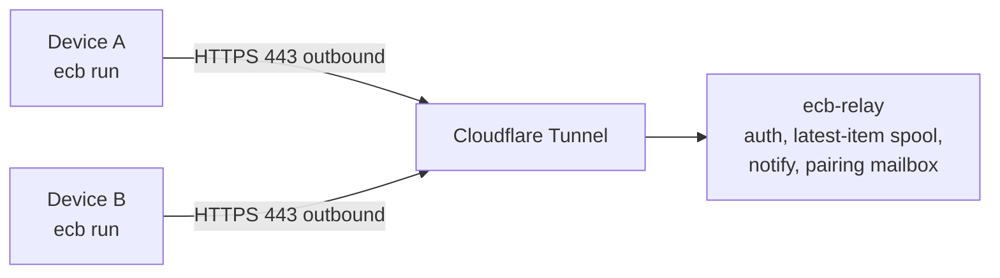

# Architecture - encrypted-cross-buffer (ecb)

Status: **as built** (the MVP is implemented). This is the short version; the full deep dive with diagrams, byte formats and the threat model is [TECHNICAL.md](TECHNICAL.md). Decisions are in [decisions/](decisions/), the original research in [research/](research/). Operations: [OPERATIONS.md](OPERATIONS.md). Security model: [SECURITY.md](SECURITY.md).

## 1. What it is

End-to-end encrypted clipboard sync between **one person's own devices** (macOS, Linux and Windows desktops). Copy on device A, paste on B and C. Content types: UTF-8 text (including 10k+ lines) and PNG images up to 8 MiB. No files, no history, no mobile yet.

## 2. Components



- `cmd/ecb` - the CLI and the sync daemon: `init`, `pair`, `join`, `devices` (`rm`), `run`, `mode`, `pause`, `resume`, `status`, `doctor`, `version`.
- `cmd/ecb-relay` - the relay. Store-and-forward only; configured by environment variables; never decrypts anything.
- The relay runs in Docker next to a `cloudflared` sidecar. No port is published; devices only make outbound HTTPS connections, which is what lets a laptop behind a corporate VPN take part.

## 3. Trust model (summary)

| Party | Trusted? | Sees |
| --- | --- | --- |
| Member devices | yes (hold all keys) | everything in the group |
| Relay, Cloudflare, network, corporate proxy | **no** | sealed items and metadata only: group id, device public keys, sender, time, size, IPs |

Accepted: a compromised member can read new items and change membership; there is no forward secrecy; the relay can drop or delay items. See [SECURITY.md](SECURITY.md).

## 4. Transport (ADR-001, 002, 003)

- **Relay-only.** P2P is deferred (Cloudflare Tunnel carries HTTP and WebSocket only; a corporate-VPN laptop cannot be reached directly). See TECHNICAL section 12.
- **Control channel:** `GET /v1/ws` WebSocket carrying tiny JSON events (`item`, `id`, `size`, `from`, `seq`), pings every 25 s, jittered backoff, resume with `?after=<seq>`. After 3 failed connections the client falls back to long-poll `GET /v1/events?after=&wait=25` for 5 minutes, then retries the WebSocket.
- **Data channel:** `POST /v1/items` (one binary frame, `Content-Length` required) and `GET /v1/items/{id}`. The relay streams the upload to a temp file, verifies the signature while streaming, atomically renames it to the group's **latest** item and deletes the previous one. Memory per request is a small buffer.
- **Limits:** 32 MiB per frame (`ECB_MAX_ITEM_BYTES`), TTL 10 minutes (`ECB_ITEM_TTL`), one item per group, 64 devices per group.

## 5. Identity, pairing, relay auth (ADR-004 to 007)

- **Device keys:** X25519 (age identity) and Ed25519 (signing), generated locally, kept in the OS keychain (or a 0600 file if allowed). `device_id = SHA-256(ed25519_pub)[:16]`.
- **Group and roster:** random 128-bit group id; a roster (device id, name, both public keys, added_by, added_at) with a monotonic version, signed by a current member, stored on the relay **encrypted to the members**. Devices accept only a higher version signed by a member of the roster they hold; retained entries must not change.
- **Create:** `ecb init --relay URL` needs the relay's `ECB_ENROLL_TOKEN` (typed or in the environment, never a flag).
- **Add a device:** `ecb pair` opens a single-use mailbox on the relay (5 minutes) and shows `7-orbit-velvet-candle`; `ecb join` on the new device enters it. Both run a P-256 PAKE through the mailbox, then mutual HMAC key confirmation, then the new device's descriptor and the new signed roster are exchanged under AEAD. About 2^-33 chance of a successful guess per pairing; no offline attack.
- **Relay auth:** the device signs `"ecb-auth-v1" || nonce || group_id` with Ed25519 and receives a 15-minute bearer token. The relay keeps the allowed key set per group and changes it only on a member-signed roster publish.
- **Revoke:** `ecb devices rm NAME` publishes a signed roster without the device; the relay drops its tokens and connections at once; future items are not encrypted to it.

## 6. Payload format (ADR-008, 009)

Inner plaintext (inside age): `ctype u8 (1 text, 2 png) | comp u8 (0 none, 1 zstd) | raw_len u64 | body`. Text is zstd-compressed per item when that shrinks it; PNG is stored unchanged. The receiver caps `raw_len` and requires an exact decoded length.

Encryption: age v1 to all other roster devices (one file key, N wrapped copies, ChaCha20-Poly1305 STREAM in 64 KiB chunks).

Outer frame v1 (62-byte header, then ciphertext, then 64-byte signature):

```
"ECB1" | ver u8=1 | flags u8=0 | group_id[16] | sender_id[16] | counter u64 | created_ms i64 | ct_len u64
| age_ciphertext[ct_len] | sig[64]
sig = Ed25519(sender_sk, "ecb-item-v1" || header(62) || SHA-256(age_ciphertext))
```

The relay and the receiver both verify the signature; the receiver does it **before** decrypting. Replay protection: per-sender counter must increase, and items older than TTL + 5 minutes or more than 5 minutes in the future are rejected.

## 7. Daemon and clipboard (ADR-010, 011)

- Clipboard access through `golang.design/x/clipboard` (no cgo): text and PNG; password-manager "sensitive" items are never synced.
- Per-device mode in `config.json`: `both`, `send-only`, `receive-only`, `paused` (changed with `ecb mode`, applied within about 2 s). Local size limits `max_text_bytes` and `max_image_bytes` default to 8 MiB.
- **Loop prevention:** SHA-256 of kind plus content of the last applied and last sent item, a 300 ms debounce, a 1.5 s echo window after applying, and de-duplication of the last 256 item ids.
- Roster refreshed at startup, every 5 minutes, on events from unknown or stale senders, and before sending.

## 8. Repository layout

```
cmd/ecb/             CLI and daemon entry point
cmd/ecb-relay/       relay entry point and container health check
internal/frame/      binary frame v1: streaming writer and verifier
internal/envelope/   zstd + age + sign/verify, replay and size checks
internal/roster/     signed device roster
internal/keystore/   identity (keychain or file), local state, file lock
internal/pairing/    codes, PAKE, key confirmation, inviter and joiner
internal/relay/      server: auth, groups, spool, event hub, mailboxes, rate limits
internal/client/     relay client: auth, items, roster, WebSocket, long-poll, mailbox
internal/daemon/     sync loop, modes, config
internal/clip/       OS clipboard and a test-only file-backed fake
test/integration/    in-process relay and clients (go test)
test/e2e/            shell test with real binaries and fake clipboards (make e2e)
contrib/             autostart examples (launchd, systemd user unit, Windows Task Scheduler)
```

There is no separate transport package: the WebSocket and long-poll transports live in `internal/client`.

## 9. Testing and delivery

`make test` (unit and integration), `make race`, `make vet`, `make fmt`, `make e2e`. CI (`.github/workflows/ci.yml`): gofmt, vet, `go test -race`, cross-builds of `ecb` (linux amd64/arm64, macOS arm64, Windows amd64), relay build, Docker build and `govulncheck`. Notable tests: relay heap stays flat during a 30 MiB upload (`TestRelayMemoryConstant`), oversize and expiry behaviour, pairing with a malicious relay, revocation, round trips across the relay.

## 10. Known gaps and future work

No forward secrecy or key rotation; no mobile app; no file transfer; no P2P (LAN or WebRTC); no metrics endpoint; no pre-built release binaries; no padding of item sizes. Details and the P2P design sketch: [TECHNICAL.md](TECHNICAL.md#19-limitations-and-non-goals).
