# ecb - technical deep dive

This document explains how `ecb` works well enough that an engineer can reason about every security property from it alone. It describes the code **as built** (not the original plan). Short overview: [ARCHITECTURE.md](ARCHITECTURE.md). Operations: [OPERATIONS.md](OPERATIONS.md). Security summary: [SECURITY.md](SECURITY.md). Decisions: [decisions/](decisions/).

Conventions: all integers on the wire are big-endian. "Device" means one installation of `ecb` with its own keys. "Group" means the set of devices that share a clipboard. Facts about Cloudflare limits are *external* and should be re-verified before you depend on them.

## Contents

1. [Overview and goals](#1-overview-and-goals)
2. [System context and trust boundaries](#2-system-context-and-trust-boundaries)
3. [Repository map](#3-repository-map)
4. [Life of a clipboard item](#4-life-of-a-clipboard-item)
5. [Wire formats](#5-wire-formats)
6. [Key hierarchy](#6-key-hierarchy)
7. [Pairing](#7-pairing)
8. [Relay authentication](#8-relay-authentication)
9. [Roster and revocation](#9-roster-and-revocation)
10. [The daemon: modes, loop prevention, sync loop](#10-the-daemon-modes-loop-prevention-sync-loop)
11. [Transport: WebSocket with long-poll fallback](#11-transport-websocket-with-long-poll-fallback)
12. [Why P2P was deferred and the future file-transfer sketch](#12-why-p2p-was-deferred-and-the-future-file-transfer-sketch)
13. [Data at rest](#13-data-at-rest)
14. [Threat model](#14-threat-model)
15. [Crypto choices and why](#15-crypto-choices-and-why)
16. [Performance](#16-performance)
17. [Relay memory behaviour](#17-relay-memory-behaviour)
18. [The PNG decision](#18-the-png-decision)
19. [Limitations and non-goals](#19-limitations-and-non-goals)
20. [How to extend](#20-how-to-extend)
21. [Glossary](#21-glossary)

## 1. Overview and goals

Goals, in priority order:

1. **The relay learns no content, no content type, no keys and no pairing code.** It is treated as hostile.
2. **Works from behind a corporate VPN**: only outbound HTTPS 443; no inbound ports, no LAN, no UDP.
3. **Large text and screenshots are fast**: per-item compression, binary framing, streaming relay.
4. **Easy for one person to operate**: one container (plus a tunnel sidecar), one three-word code per new device.

Design in one paragraph: every device has two long-lived keys (X25519 for decryption, Ed25519 for signing). A signed, member-maintained **roster** lists the group's devices. To send, a device compresses the item, encrypts it with **age** to every other device in the roster, wraps it in a binary **frame** and signs the frame. The relay verifies the signature against the group's allowed keys, keeps only the latest item per group on disk for 10 minutes and notifies the other devices over a WebSocket. Receivers fetch the item, verify the signature **before** decrypting, then decrypt, decompress and write the clipboard. New devices join through a one-time code and a password-authenticated key exchange (PAKE) run through a relay mailbox.

## 2. System context and trust boundaries

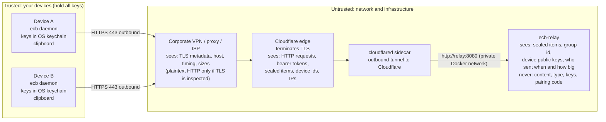

What each party can and cannot do:

| Party | Can see | Cannot do |
| --- | --- | --- |
| Device in the group | Everything copied after it was added; can add and remove devices | - |
| Relay operator or attacker on the relay host | Sealed items (up to 10 min), `groups.json` (group id, device public keys, sealed roster), request metadata | Read content; forge items (no signing key); add devices (roster changes need a member signature) |
| Cloudflare | Same as the relay, plus client IPs, and the bearer tokens in transit (TLS is terminated there) | Read content; forge items |
| Corporate proxy with TLS inspection | Same as Cloudflare for requests that pass through it | Read content; forge items |
| Passive observer without inspection | Destination host, packet sizes, timing | Anything inside TLS |

The only secrets that matter are the device private keys. They never leave the device, and are never sent to or derived by the relay.

## 3. Repository map

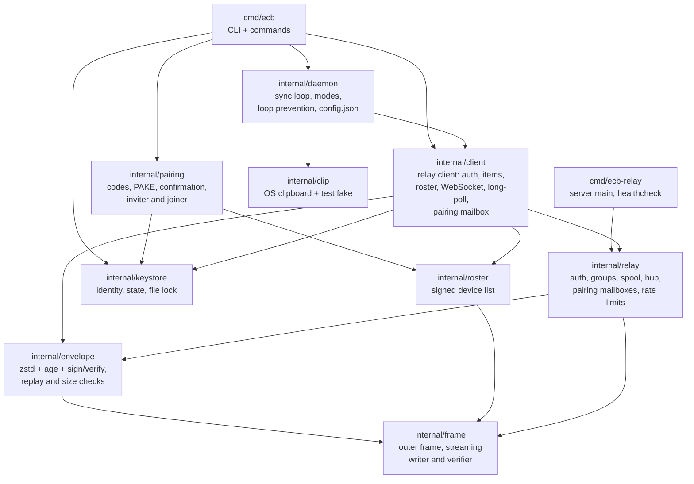

Notes. `internal/client` imports `internal/relay` only for the shared signed-message builders (`AuthMessage`, `RosterPubMessage`, `GroupCreateMessage`). `internal/relay` imports `envelope` only for the clock-skew constant and `frame` for streaming verification. There is no separate transport package: the WebSocket and long-poll transports live in `internal/client/events.go`, and the daemon wraps them to add readiness and revocation detection.

## 4. Life of a clipboard item

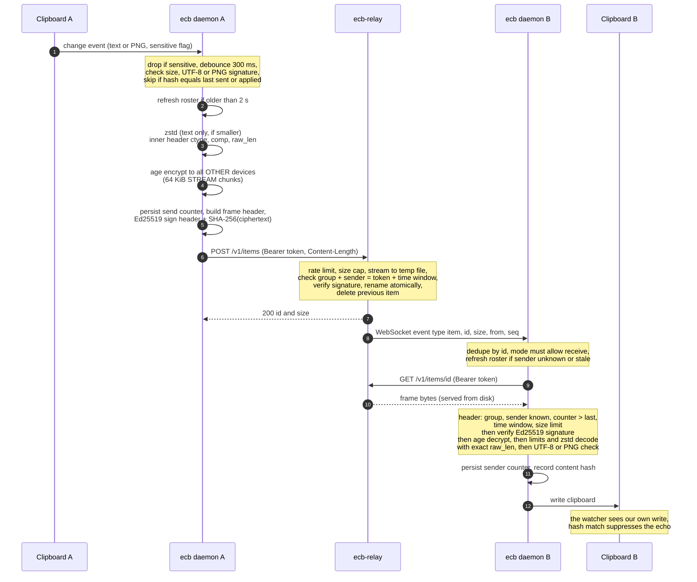

Properties worth noting:

- The sender is **not** a recipient of its own item (no point), and a roster with no other device yields `no other devices in the group yet; nothing sent`.
- The client builds the whole frame in memory (up to 32 MiB) because the relay requires `Content-Length`. The **relay** streams; see [section 17](#17-relay-memory-behaviour).
- The relay's checks (signature, sender, group, time window) stop garbage and outsiders. The **receiver's** checks are the real security boundary, because the relay is untrusted.
- Relay events are not signed and carry only `id`, `size`, `from`, `seq`. A forged event can at worst make a receiver fetch an item, which then fails verification.
- The receiver records the sender's counter only after full verification and decryption, so a bad item cannot burn counters.

## 5. Wire formats

### 5.1 Outer frame (version 1)

Implemented in `internal/frame`. Header is exactly 62 bytes, the signature is 64 bytes, so the overhead is 126 bytes.

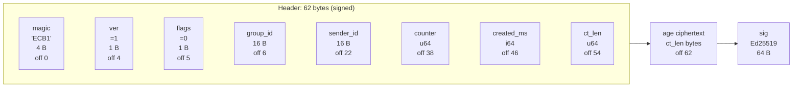

| Field | Offset | Size | Meaning |
| --- | --- | --- | --- |
| magic | 0 | 4 | ASCII `ECB1` |
| ver | 4 | 1 | `1`; other values rejected |
| flags | 5 | 1 | must be `0`; reserved bits are rejected |
| group_id | 6 | 16 | random group identifier |
| sender_id | 22 | 16 | `SHA-256(sender Ed25519 public key)[:16]` |
| counter | 38 | 8 | per-sender monotonic send counter, starts at 1 |
| created_ms | 46 | 8 | sender wall clock, Unix milliseconds |
| ct_len | 54 | 8 | length of the age ciphertext |
| ciphertext | 62 | ct_len | age v1 binary file |
| sig | 62+ct_len | 64 | `Ed25519(sender_sk, "ecb-item-v1" || header(62 B) || SHA-256(ciphertext))` |

The header is authenticated (it is signed) but not encrypted, so the relay can route and check items. A parser must reject: wrong magic, version or flags, `ct_len` above the limit, truncation and trailing bytes after the signature (all covered by tests in `internal/frame`).

### 5.2 Inner plaintext (inside age)

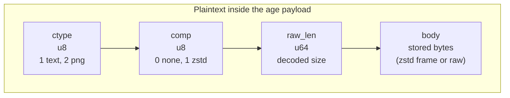

Receiver rules: `ctype` must be known; `raw_len` must not exceed the per-type limit (default text 256 MiB at the envelope level, image 8 MiB; the daemon applies its own `max_text_bytes` / `max_image_bytes`); zstd is allowed for text only; the decoder is capped (`WithDecoderMaxMemory(raw_len + 1 MiB)`, window 64 MiB) and the result must be exactly `raw_len` bytes; no trailing plaintext is allowed; text must be valid UTF-8 and images must start with the PNG signature.

### 5.3 Other formats

- **Roster** (`internal/roster`): `"ECBR" | fmt u8=1 | group_id[16] | version u64 | signer[16] | n u16 | n x entry | sig[64]`, entry = `device_id[16] | name_len u8 | name | x25519_len u8 | age recipient string | ed25519_pk[32] | added_by[16] | added_at_ms i64`. Entries are sorted by device id. The signature covers `"ecb-roster-v1" || everything before sig`. The marshalled roster is then **age-encrypted to all of its members** ("sealed") before it goes to the relay.
- **Relay-signed control messages** (`internal/relay/wire.go`): group create `"ecb-group-create-v1" || group_id || ed25519_pub || SHA-256(blob) || version u64`; roster publish `"ecb-roster-pub-v1" || group_id || version u64 || SHA-256(blob) || keys (32 B each, sorted)`; auth `"ecb-auth-v1" || nonce || group_id`.
- **Relay API** (JSON over HTTPS, items are raw bytes):

| Endpoint | Auth | Purpose |
| --- | --- | --- |
| `GET /healthz` | none | liveness, returns `ok` |
| `POST /v1/groups` | `X-ECB-Enroll` header | create a group |
| `POST /v1/auth/challenge`, `POST /v1/auth/token` | none (signature) | obtain a session token |
| `GET/POST /v1/groups/{gid}/roster` | Bearer | fetch / publish the sealed roster and key set |
| `POST /v1/items`, `GET /v1/items/{id}` | Bearer | upload / download the latest item |
| `GET /v1/ws` | Bearer (header, or `?token=`) | WebSocket event stream |
| `GET /v1/events?after=&wait=` | Bearer | long-poll event stream (wait up to 25 s) |
| `POST /v1/pair` | Bearer | open a pairing mailbox |
| `POST/GET /v1/pair/{n}/msg`, `DELETE /v1/pair/{n}` | none (mailbox number) | pairing messages |

## 6. Key hierarchy

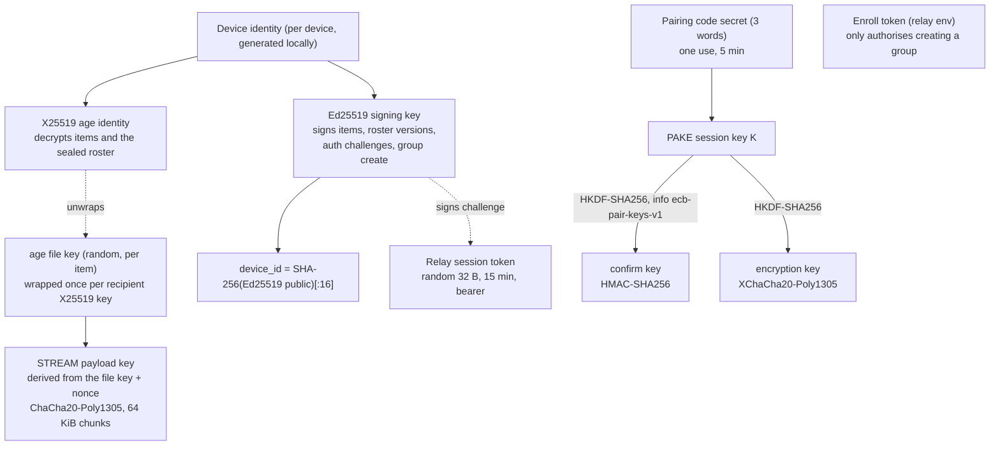

| Key | Lives | Used for | Lifetime |
| --- | --- | --- | --- |
| Ed25519 signing key | OS keychain (or 0600 file) | sign items, roster, auth, group create | until the device is re-initialised |
| X25519 age identity | OS keychain (or 0600 file) | decrypt items and the roster | same |
| age file key | transient | one per item; wrapped for each recipient | one item |
| PAKE session key, confirm key, enc key | transient memory | pairing only | one pairing, at most 5 min |
| Session token | transient memory on client and relay (relay stores only its SHA-256) | authorise API calls | 15 min, refreshed automatically |
| Enroll token | relay environment, typed once on the first device | allow `POST /v1/groups` | until you rotate it |

There is no group-wide symmetric key. Each item is encrypted to the current set of device public keys, which is why removing a device takes effect for all *future* items immediately and why there is no forward secrecy.

## 7. Pairing

Goal: add a new device without ever giving the relay anything it could use to impersonate either side, using a code short enough to type.

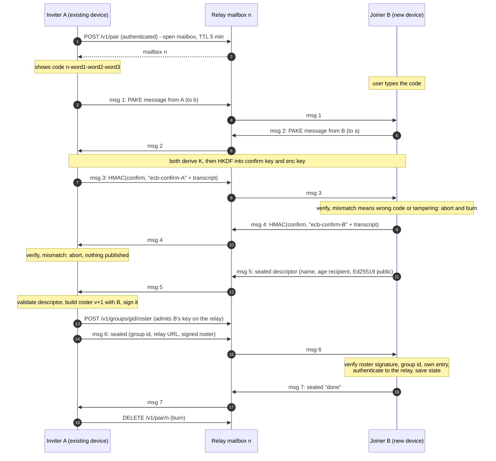

Details:

- **Code**: `<mailbox 1-99>-<w1>-<w2>-<w3>`, words drawn uniformly from the embedded 2048-word BIP-39 list (`internal/pairing/wordlist.txt`), so the secret has **33 bits** (3 x 11). `ecb pair --code` accepts a user-chosen secret (at least 8 characters; shorter than 12 prints a warning; it is visible in the process list). The whole code string is the PAKE password.
- **PAKE**: `schollz/pake/v3`, curve P-256, both identities set to `ecb-pair-v1|<mailbox>`. The wrapper allows exactly one `Update` (the library silently overwrites the key on a second call) and converts panics on hostile input into errors.
- **Key confirmation** is added by `ecb` because the PAKE library does not provide it: HKDF-SHA256 over the PAKE key (info `ecb-pair-keys-v1`) gives 64 bytes, the first 32 are the confirm key, the last 32 the encryption key. Each side sends `HMAC-SHA256(confirm, "ecb-confirm-" + role + transcript)`, where the transcript is the length-prefixed concatenation of both PAKE messages. Both sides must verify before anything sensitive happens. The joiner does **not** reveal its descriptor until both confirmations pass.
- **Sealed messages** use XChaCha20-Poly1305 with a random 24-byte nonce and associated data `label + mailbox` (labels `ecb-desc-v1`, `ecb-roster-v1`, `ecb-done-v1`).
- **Order of effects**: the inviter validates the descriptor, builds and size-checks the reply, **then** publishes the roster to the relay, then sends msg 6. Nothing is published unless confirmation passed.
- **Relay-side limits**: a mailbox accepts at most 8 messages in total (a normal pairing uses 7), each at most 16 KiB, and is burned when a 9th is posted; at most 4 open mailboxes per group; mailbox numbers are 1-99; the unauthenticated mailbox endpoints are rate limited per IP (burst 30, one token per 200 ms).

Security argument: an attacker who controls the relay (or Cloudflare) sees only PAKE messages, confirmations and AEAD ciphertext. To pair as the new device the attacker must guess the 33-bit secret in **one** online attempt, because the mailbox is single-use: a failed confirmation burns it. That is a success chance of about 2^-33 per pairing, with no offline attack (a transcript does not allow testing guesses). A man in the middle who does not know the secret cannot produce a valid confirmation MAC, so the inviter aborts before publishing. The cost of the design is that an active attacker can always *deny* pairing (burn mailboxes), and a visible failure is the signal.

Mailbox state:

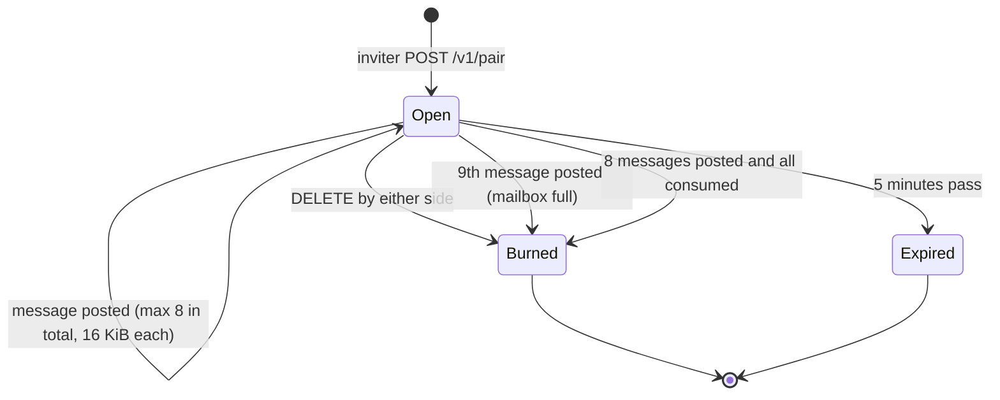

An error on either side makes it call `DELETE` at once (inviter always burns at the end; the joiner burns on any failure), so a mailbox serves exactly one attempt.

## 8. Relay authentication

The relay authenticates **devices**, not users: it holds the Ed25519 public keys allowed for each group and checks a signature over a fresh nonce.

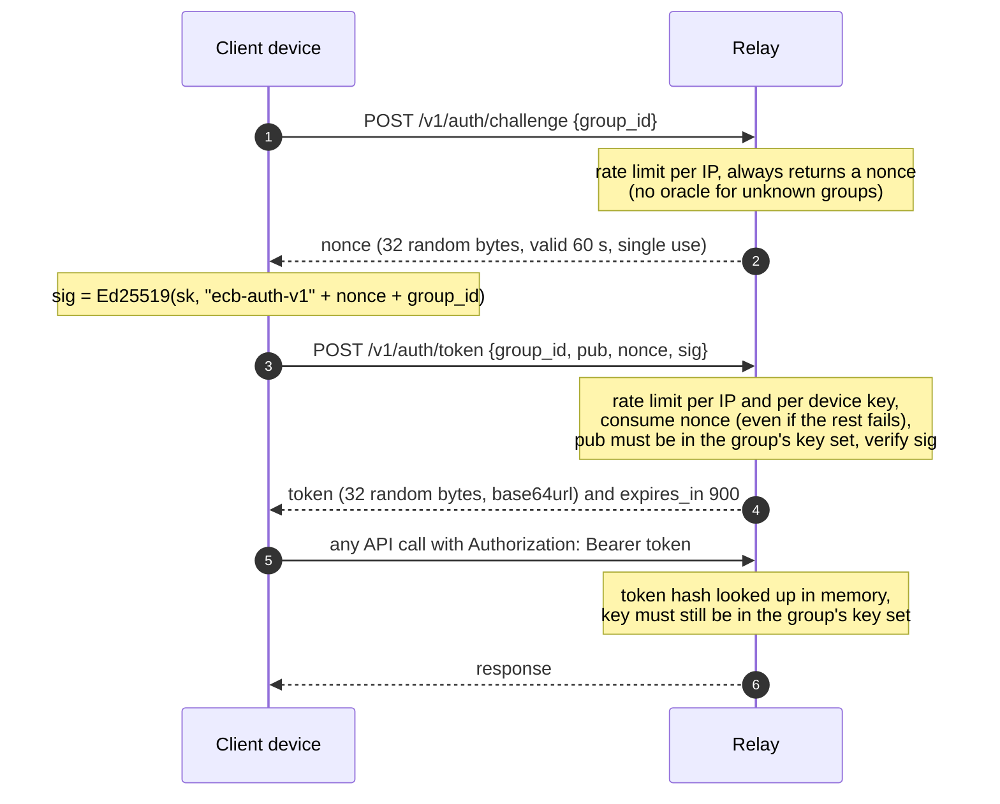

- Tokens are random, kept only in relay memory as SHA-256 hashes, last 15 minutes, and are tied to (group, key). Every request re-checks that the key is still in the group's key set, so removing a key kills its tokens immediately.
- The client refreshes tokens 30 s early and re-authenticates once on a 401.
- `GET /v1/ws` also accepts the token as `?token=` (browsers cannot set headers on WebSockets). The `ecb` client uses the header. The relay never logs query strings.
- **Group creation** needs `X-ECB-Enroll: <ECB_ENROLL_TOKEN>` (compared in constant time after hashing) and a signature by the new device's key over the roster blob; after 5 failed attempts an IP is limited to one further attempt per minute (HTTP 429).
- Rate limits (in memory, per process): enroll failures 5 burst / 1 per minute per IP; auth 30 burst / 1 per 500 ms per IP; token per device key 10 burst / 1 per second; pairing endpoints 30 burst / 1 per 200 ms per IP, and mailbox-burning requests (DELETE, or a post to a full mailbox) 10 burst / 1 per 6 s per IP so nobody can cheaply destroy other people's pairings; item uploads 30 burst / 1 per 500 ms per device. Each limiter holds at most 10,000 keys (least recently used evicted). With `ECB_TRUST_PROXY_HEADERS=true` the client IP is taken from the `CF-Connecting-IP` header parsed as a literal IP (`X-Forwarded-For` is never trusted, and no DNS lookup is done); otherwise from the socket.

## 9. Roster and revocation

The roster is the group's membership list, signed by a member and versioned.

Receiving rules (`Roster.Verify`): the version must be higher than the held roster; the group id must match; the **signer must be a member of the held roster** (so a removed device cannot sign the next version); any device new relative to the held roster must have `added_by` equal to the signer; every retained device must be **field-for-field identical** to the held entry (a signer cannot swap another member's keys or rename it); the signature must verify.

Trust caveats, kept honest:

- The very first roster a joining device sees comes through the authenticated pairing channel (trust on first use of *that* channel), never from the relay. After that every roster is verified against the previous one.
- A device holding a stale roster accepts a newer roster signed by a member that has since been removed (that member is still in *its* held roster). Closing that window needs the relay to enforce the current roster; the relay does enforce the key set on every API call, which narrows it.

Revocation:

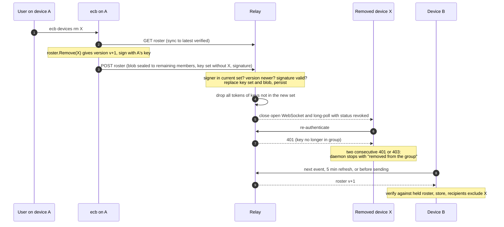

What revocation does and does not do:

- It stops the removed device from authenticating, fetching items or sending items (the relay rejects it, and other devices would reject its signatures anyway).
- All **future** items are not encrypted to it. Devices pick up the new roster on the next event, the 5-minute refresh, or at send time if their copy is older than 2 seconds.
- It cannot un-share what the device already received, and it does not help against a device whose key was stolen *and* used to read earlier ciphertext captured elsewhere (no forward secrecy).
- It cannot happen without a member's signature: the relay alone cannot remove or add devices.

## 10. The daemon: modes, loop prevention, sync loop

`internal/daemon` runs one goroutine owning all state. It selects over: remote events, local clipboard events, a debounce timer, a config poll (every 2 s) and a roster refresh (every 5 min).

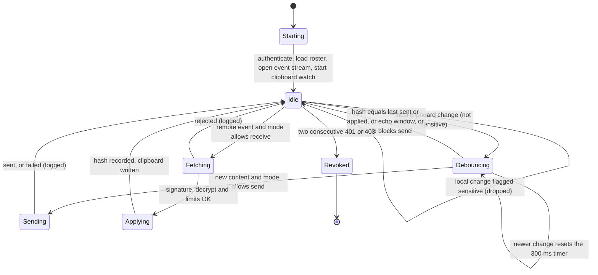

Modes (`config.json`, changed with `ecb mode`, picked up within 2 s):

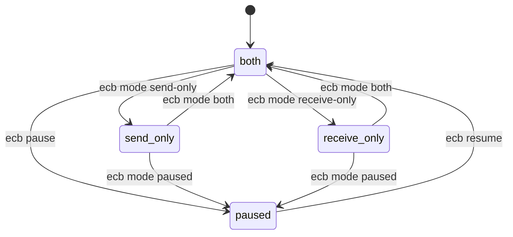

| Mode | Local changes | Remote items |
| --- | --- | --- |
| `both` | sent | applied |
| `send-only` | sent | ignored (not even fetched) |
| `receive-only` | ignored | applied |
| `paused` | ignored | ignored |

**Loop prevention** (three layers):

1. **Content hash**: before writing a remote item the daemon stores `SHA-256(kind || bytes)` as `lastApplied`; when the OS clipboard watcher reports our own write, the hash matches and nothing is sent. The hash of the last *sent* item is also remembered, which suppresses repeats.
2. **Echo window** (1.5 s): after applying an item of a kind, local events of the same kind are ignored, because some operating systems hand back re-encoded content whose hash differs (typical for images).
3. **Event de-duplication**: the daemon remembers the last 256 item ids, and the relay never sends a device its own events.

Other behaviour:

- **Sensitive items** (flag set by password managers, reported by the clipboard library) are never sent, and a pending older item is cancelled so it cannot be sent in their place.
- **Limits**: local text above `max_text_bytes` or images above `max_image_bytes` are not sent (warning logged); received items above the receiver's own limits are not applied.
- **Roster freshness**: refreshed at startup, every 5 minutes, when an event comes from an unknown sender or the copy is older than 30 s, and before sending when older than 2 s.
- **Revocation detection**: a 401/403 triggers two re-authentication attempts 150 ms apart; two failures mean permanent refusal and the daemon exits with an error so a service manager does not retry forever (see the `StartLimit` settings in `contrib/ecb.service`).
- **Logs** never contain clipboard content or key material.

## 11. Transport: WebSocket with long-poll fallback

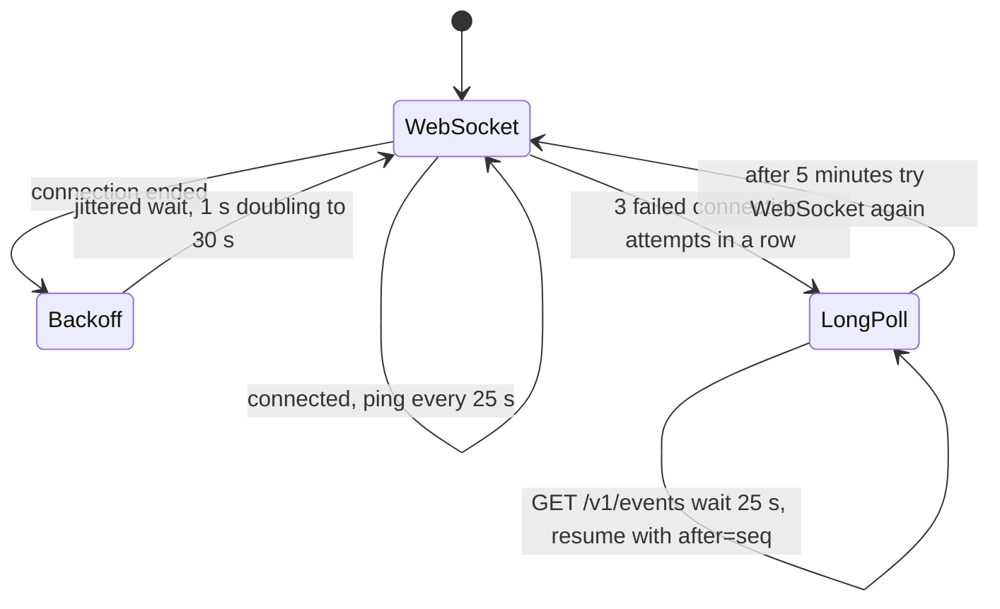

- **Control channel** (tiny JSON notifications) is separate from the **data channel** (`POST/GET /v1/items`). Large payloads never travel over the WebSocket, so proxies that mangle WebSockets cannot corrupt items and the relay can stream them to disk.
- On connect the relay sends `{"t":"hello","seq":N}`; the client keeps the highest `seq` and resumes with `?after=<seq>` after a reconnect. The relay keeps a ring of the last 64 events per group in memory, so a short outage does not lose notifications. Events are de-duplicated by `seq`.
- Both sides ping (client every 25 s; the relay pings every 25 s too) to keep the connection alive through idle timeouts. *Per third-party reports Cloudflare closes idle WebSockets after roughly 100 seconds; this was not verified.*
- Backoff: jittered ("equal jitter": half to full of the current delay), starting at 1 s, doubling to a 30 s maximum.
- **Fallback**: after 3 consecutive failed WebSocket connections the daemon switches to long-poll for 5 minutes, then tries WebSocket again. Long-poll is ordinary HTTPS requests that last up to 25 s, which survive most proxies.
- On revocation the relay closes the WebSocket with status `policy violation` and reason `revoked`, and answers long-polls with 401.

`ecb doctor` exercises this path (DNS, TCP, TLS with issuer check, `/healthz`, login, an authenticated WebSocket hold with pings, then the long-poll check) and reports PASS, PASS-WITH-FALLBACK or FAIL (see the README section on corporate VPNs).

## 12. Why P2P was deferred and the future file-transfer sketch

**Decision (ADR-001): relay only, P2P later.** Reasons:

- The hardest requirement is a laptop on a corporate VPN (a NordLayer-style product in the original setting) that cannot be reached from the LAN or from mesh VPNs such as Tailscale. Direct connections would not help *that* device; a relay on outbound 443 does.
- **Cloudflare Tunnel carries HTTP and WebSocket only.** It cannot carry UDP, so a TURN relay (needed for WebRTC when direct connection fails) cannot sit behind the same tunnel. A TURN-over-TLS server would need a separate host with its own public port.
- Cloudflare also limits request bodies (about 100 MB on lower plans, *external, re-verify*). The relay cap of 32 MiB stays well below it.
- Clipboard items are small, so relaying every byte is cheap, and the relay keeps only one item per group for 10 minutes.
- The payload format is already end-to-end encrypted and signed, so a P2P path would change only *how bytes are fetched*, not the security model.

**Sketch for later (not implemented): P2P file transfer.**

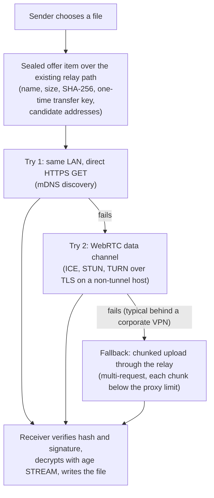

- Reuse the signed, age-encrypted envelope, adding a new content type with a manifest (name, size, chunk hashes), so the relay still sees only opaque bytes.
- The relay would be a signalling and fallback store, never a trusted party.
- It needs its own ADR for chunking and resume, large-item limits, and where files are written.

## 13. Data at rest

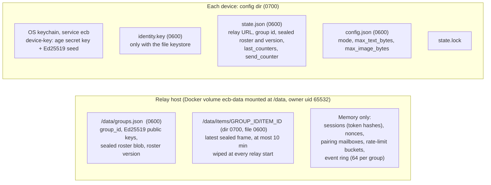

Device config directory: macOS `~/Library/Application Support/ecb`, Linux `$XDG_CONFIG_HOME/ecb` or `~/.config/ecb`, Windows `%AppData%\ecb` (override with `ECB_CONFIG_DIR`). Unix permissions are enforced (the identity file is refused if group- or world-accessible); on Windows the unix mode bits have no effect and the directory's ACL applies.

| What | Where | Sensitive? | Notes |
| --- | --- | --- | --- |
| Device private keys | OS keychain or `identity.key` | **Yes** | Anyone who obtains them can read future items and impersonate the device. |
| Sealed roster | relay `groups.json`, device `state.json` | No (encrypted to members) | Relay also stores the plain Ed25519 key list, which it needs for auth. |
| Items | relay `items/` (ciphertext) | No | At most one per group, 10 min, never persisted across restarts. |
| Counters | `state.json` | No | Needed for replay protection; deleting it resets them (see limitations). Updated under a cross-process file lock (`state.lock`) and merged by maximum, so a CLI command and the daemon cannot reuse a counter. The stored roster only moves forward (a stale in-memory copy cannot roll it back). |
| Plaintext clipboard | nowhere on disk | - | Only in OS clipboard and process memory. |
| Enroll token | relay environment / `.env` | **Yes** (authorises group creation only) | Never stored by `ecb`; never accepted as a flag. |

Writes of `groups.json`, `state.json` and `config.json` are atomic (temp file, then rename). The relay container runs as non-root with a read-only root filesystem, no capabilities, `no-new-privileges`, 512 MB memory limit and a `/tmp` tmpfs.

## 14. Threat model

Assets: clipboard content, device private keys, group membership integrity, relay availability.

| Attacker | Capability | Outcome |
| --- | --- | --- |
| Passive network observer (ISP, VPN) | Observe TLS traffic | Sees destination host, sizes, timing. No content. |
| Corporate proxy with TLS inspection | Decrypt TLS, read HTTP | Sees sealed items, bearer tokens (15 min), device ids, metadata. No content, cannot forge items. A stolen token lets it download the latest sealed item and open pairing mailboxes (DoS), nothing more. |
| Cloudflare (or any TLS-terminating front) | Same as the proxy | Same outcome. |
| Relay operator / relay compromise | Read the disk, modify the code | Sees sealed items and metadata. **Can** drop, delay or reorder items (availability). Cannot forge items, cannot add or remove devices (needs a member signature), cannot read the roster. Replays within 10 minutes are rejected by receivers' counters. |
| Stranger who finds the relay URL | Call public endpoints | Cannot create a group without `ECB_ENROLL_TOKEN` (after 5 failures an IP gets 1 attempt per minute); cannot authenticate without a member key. Can probe `/healthz`, generate nonces (bounded), and poke mailbox numbers (rate limited). |
| Pairing attacker (guesses the code or controls the relay) | One online guess per pairing | Succeeds with probability about 2^-33 per pairing for generated codes; a failed attempt burns the mailbox and shows the legitimate user an error. No offline attack. |
| Attacker with a stolen, powered-on, unlocked device | Everything the user can do | Reads new items; can add or remove devices. Mitigation: `ecb devices rm` from another device. |
| Attacker with a stolen device key **later** | Decrypt captured ciphertext | **Succeeds for captured items** (no forward secrecy). Relay deletes items after 10 min, but a proxy or backup may keep them. |
| Malware or another user on a member machine | Read the OS clipboard, files in the config dir | Clipboard is exposed by definition. Keychain storage protects the key from other users; the file keystore does not protect against the same user. |
| Malicious or buggy member device | Send crafted items | Bounded by caps: 32 MiB ciphertext, `raw_len` limits, exact-length zstd decode, UTF-8 and PNG-signature checks. A member can still overwrite a clipboard with junk (it is a member). |
| Denial of service on the relay | Floods | Rate limits, body size caps, memory-bounded streaming, container limits. A determined flood can still exhaust a small host; Cloudflare is in front by design. |
| Clock skew or replay | Old or future-dated items | Receivers reject items older than TTL + 5 min or more than 5 min in the future, and counters must increase. |
| Traffic analysis | Sizes and timing | Item sizes, sender, and times are visible. No padding. |

Out of scope: a compromised operating system, hardware attacks, shoulder surfing, malware that reads the keychain as the user, quantum adversaries (X25519 and Ed25519 are not post-quantum).

## 15. Crypto choices and why

| Choice | Why |
| --- | --- |
| **age v1** (X25519 + ChaCha20-Poly1305 STREAM, 64 KiB chunks) for item encryption | A small, audited, well-specified format with multi-recipient support (one payload, one wrapped key per recipient, so the cost is not N times the payload). STREAM gives chunked authenticated encryption that detects truncation. Writing our own X25519 + AEAD stream would re-implement age with more risk. Alternatives rejected: NaCl box per device (N copies of the payload), Noise sessions (do not fit store-and-forward). |
| **Detached Ed25519 signature** over `header || SHA-256(ciphertext)` | age gives **confidentiality and integrity but no sender authentication** (any holder of a public key can encrypt to it). The signature proves which roster member sent the item, lets the relay reject outsiders cheaply while streaming, and covers the header (group, sender, counter, time). |
| **Ed25519 for identity** | Small keys and signatures, fast, deterministic, in Go's standard library. `device_id` is a hash of the public key, so it cannot be spoofed independently of the key. |
| **Separate X25519 and Ed25519 keys** | Avoids key-reuse across algorithms and keeps age's identity format unmodified. |
| **PAKE (schollz/pake v3, P-256) for pairing** | A three-word code is guessable offline if used as a shared key or password. PAKE turns it into a key where each guess needs an online interaction; combined with single-use mailboxes that is one guess per pairing. P-256 is a standard curve that the library supports and that Go's standard library implements. CPace was considered but rejected as too experimental at the time. |
| **Explicit key confirmation (HMAC-SHA256)** | The library does not authenticate the derived key. Without confirmation a tampering relay could make both sides derive different keys silently, or learn whether a guess was right. |
| **XChaCha20-Poly1305 for pairing messages** | 24-byte random nonces are safe without a counter; same family as age's ChaCha20-Poly1305. |
| **Per-item zstd** (klauspost/compress) | Large pasted text typically compresses several-fold (typical behaviour, not measured here). Compression is applied **per item, never across items**, and inside the encryption, so lengths leak no cross-item information; it is skipped for PNG (already compressed) and when it would not shrink the text. A decoder cap prevents zip bombs. |
| **64 KiB STREAM chunks** | age's fixed chunk size; bounds memory per chunk and gives authenticated truncation detection. |
| **Per-sender replay counter + timestamp window** | Store-and-forward means the relay *could* resend an old item. A strictly increasing per-sender counter (persisted before sending, and recorded after verification) plus a TTL + 5 min age limit makes replays useless. |
| **Binary framing, no JSON or base64 on the data path** | Avoids a ~33% size increase and parsing costs for large items. JSON is used only for small control messages. |
| **Member-signed roster, immutable retained entries** | Prevents the relay or one member from silently swapping keys; makes membership auditable by every device. |

## 16. Performance

Measured with the repository's benchmarks, 20 iterations each (`-benchtime=20x`, so expect noise), Go 1.26.2:

Command: `go test ./internal/envelope -run '^$' -bench . -benchtime=20x`

Machine: Apple M1 Pro (darwin/arm64), GOMAXPROCS 8 (the `-8` suffix in the benchmark names).

| Benchmark | Result (run 1 / run 2) | Meaning |
| --- | --- | --- |
| `BenchmarkSeal1MiBText` | 4.51 ms/op (232.6 MB/s) / 4.26 ms/op (246.3 MB/s) | Compress + encrypt to 3 recipients + frame + sign, 1 MiB of repetitive text |
| `BenchmarkOpen1MiBText` | 1.26 ms/op (834.1 MB/s) / 1.27 ms/op (824.6 MB/s) | Verify + decrypt + decompress the same item |

How to read this: the crypto and compression cost for a typical clipboard item (even 10,000 lines, roughly 0.5 to 1 MB) is a few milliseconds on a modern laptop. The test text is highly repetitive, so it compresses well and is *not* a worst case; incompressible data costs more in encryption and (for upload) in bytes. End-to-end latency is dominated by the network round trips (upload, event, download), plus the 300 ms debounce. A target of "10k lines each way in under 3 seconds" is therefore dominated by link speed, not by CPU. Estimates for compression ratio (10 to 30 % of the original for ordinary text) are **estimates**, not measured here.

Size overhead per item: 126 bytes of frame, 10 bytes of inner header, the age header (about a hundred bytes per recipient, *approximate*) and 16 bytes of authentication per 64 KiB chunk.

## 17. Relay memory behaviour

The relay never holds an item in memory. `POST /v1/items` reads the body through `http.MaxBytesReader`, tees it into a temp file while `frame.Verifier` parses the header and hashes the ciphertext in 64 KiB pieces, checks the signature at the end and atomically renames the file into place. `GET /v1/items/{id}` serves the file with `http.ServeContent`. Memory per request is therefore a small buffer, independent of item size; disk use is bounded by (item cap) x (number of groups) plus in-flight temp files.

The test `TestRelayMemoryConstant` in `test/integration/items_test.go` measures it: it uploads a 30 MiB frame, samples `runtime.MemStats.HeapInuse` every millisecond, and asserts that the peak minus the baseline stays below 8 MiB (a relay that read the body into memory would exceed 30 MiB). On the machine above a run printed `baseline=1728 KiB peak=1888 KiB growth=160 KiB`. The test runs the relay and the client in one process, so it is an upper bound for the relay alone.

Other memory is bounded by constants: at most 20,000 outstanding nonces and 20,000 sessions, 99 mailboxes (8 x 16 KiB each at most), 64 events per group, and rate-limit buckets that are swept when idle and capped at 10,000 per limiter.

## 18. The PNG decision

From ADR-011: clipboard items are `text/utf-8` or `image/png`, nothing else. Images are sent as the **PNG bytes unchanged**: no re-encoding and no zstd, because PNG is already deflate-compressed. The client refuses images above **8 MiB** (`max_image_bytes`); the relay's 32 MiB cap is unchanged. PNG suits screenshots (flat colours and sharp text), operating systems expose PNG or something trivially converted, and JPEG is lossy and poor for UI text while WebP/AVIF need heavy dependencies. Receivers check the 8-byte PNG signature and reject unknown content types. Files and folders are not synced; large transfers are the subject of the P2P sketch in [section 12](#12-why-p2p-was-deferred-and-the-future-file-transfer-sketch).

## 19. Limitations and non-goals

- **No forward secrecy**; no key rotation (retained roster entries are immutable by design, so rotation needs a new design).
- **Metadata is visible to the relay and Cloudflare** (group id, device keys and count, sender, time, size, IP).
- **A compromised member** can read all new items and change membership.
- **Availability is not guaranteed**: the relay can drop items; only the **latest** item per group is kept, for 10 minutes. No history, no offline queue beyond that.
- **Replay state is local**: deleting `state.json` on a device resets its counters, so a device that lost its state could in theory re-accept an item still inside the 10-minute window.
- **Pairing codes are short** (33 bits): safe because of the single online guess, but a pairing session can be denied by an active attacker.
- **No mobile, no file transfer, no P2P, no multi-group per device** yet. A device belongs to exactly one group per config directory.
- **Clipboard semantics**: only text and PNG; no rich text, no HTML, no primary selection. The password-manager flag depends on the copying app.
- **No audit.** Not post-quantum.
- Non-goals: being a general file-sharing tool, a multi-user product (all devices are one person's), or hiding that you use it.

## 20. How to extend

**Add a content type.** (1) Add a `CType...` constant in `internal/envelope` and a case in `Limits.forType`; add validation (like the PNG signature check) in `Seal` and `Open`. (2) Add a `Kind` in `internal/clip` and map it in `system.go` (`Watch`, `Write`). (3) Add the case in `daemon.handleLocal` and `daemon.handleRemote`, and a size limit in `daemon.Config`. (4) Write an ADR. Old receivers reject unknown `ctype`, so **upgrade all devices first**, or senders will cause warnings on devices that cannot read the new type.

**Change the frame.** Bump `frame.Version` and keep the old parser; receivers reject unknown versions today. Because the signature covers the header, fields can be added in a new version without ambiguity.

**Key rotation / forward secrecy.** `Roster.Verify` forbids modifying retained entries. A rotation scheme needs either "remove and re-add the device with a new id" (re-pairing) or a new roster entry kind that allows a signed key replacement, plus a decision on how to treat in-flight items. For forward secrecy of items, per-item ephemeral recipients do not help (age already uses an ephemeral key per recipient stanza, but the *recipient* key is long-lived); true forward secrecy needs ratcheting sessions, which conflicts with store-and-forward to offline devices.

**P2P.** The fetch path is `Client.FetchItem` and the notification path is the `client.Transport` interface. A P2P path would add a locator to the event or to a signed offer item and fetch the same signed frame from the peer. See section 12.

**Another relay implementation.** The API in section 5.3 is small. Any server that implements the endpoints, verifies signatures with `frame.Verifier` and stores the latest item will work.

## 21. Glossary

| Term | Meaning |
| --- | --- |
| **age** | A simple, modern file encryption format and Go library (`filippo.io/age`). |
| **AEAD** | Authenticated encryption with associated data. |
| **Burn** | Delete a pairing mailbox so it cannot be used again. |
| **Counter** | Per-sender, strictly increasing number in each frame, used against replay. |
| **Device id** | First 16 bytes of SHA-256 of a device's Ed25519 public key. |
| **E2EE** | End-to-end encryption: only the sending and receiving devices hold the keys. |
| **Enroll token** | A server-side secret needed once to create a group on the relay. |
| **Frame** | The outer binary container of an item: header, age ciphertext, signature. |
| **Group** | The set of devices that share a clipboard; identified by a random 128-bit id. |
| **Inviter / joiner** | The existing device that admits a new device / the new device, during pairing. |
| **Mailbox** | A temporary relay-side message queue used during pairing. |
| **PAKE** | Password-authenticated key exchange: a shared low-entropy secret becomes a strong key without allowing offline guessing. |
| **Relay** | The server (`ecb-relay`); stores and forwards sealed items; untrusted. |
| **Roster** | The signed, versioned list of a group's devices and their public keys. |
| **Sealed** | Encrypted with age to the members of a group (used for the roster blob). |
| **STREAM** | A construction that encrypts a long message as authenticated chunks. |
| **TTL** | Time to live: how long the relay keeps an item (10 minutes by default). |
| **TOFU** | Trust on first use. |
| **zstd** | Zstandard compression. |
